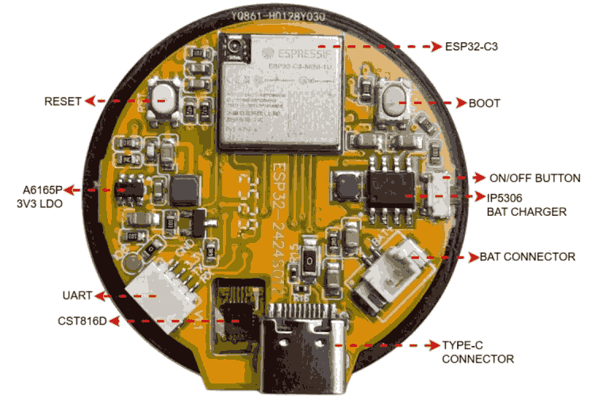

# BSP: esp32c3_2424s012c

| [HW Reference](https://circuitdigest.com/review/inside-the-esp32-2424s012c-development-board-teardown) | [HOW TO USE API](API.md) |
| --- | --- |

> This board support package was **generated with the [ESP-BSP Generator](https://bsp-generator.espressif.tools)**. Keep the saved configuration JSON from your run so you can reload it, adjust pins or features, and regenerate when ESP-IDF or BSP templates change — instead of editing generated files by hand.

## Overview

<table>
<tr><td>

esp32c3_2424s012c

</td><td width="200" valign="top">
  
</td></tr>
</table>

## Capabilities and dependencies

<!-- START_DEPENDENCIES -->

|     Available    |       Capability       |Controller/Codec|                                                   Component                                                  |  Version  |
|------------------|------------------------|----------------|--------------------------------------------------------------------------------------------------------------|-----------|
|:heavy_check_mark:|     :pager: DISPLAY    |                |   idf [espressif/esp_lcd_gc9a01](https://components.espressif.com/components/espressif/esp_lcd_gc9a01)   |>=5.2 *|
|:heavy_check_mark:|:black_circle: LVGL_PORT|                |        [espressif/esp_lvgl_port](https://components.espressif.com/components/espressif/esp_lvgl_port)        |     ^2    |
|:heavy_check_mark:|    :point_up: TOUCH    |                |[espressif/esp_lcd_touch_cst816s](https://components.espressif.com/components/espressif/esp_lcd_touch_cst816s)|     *     |
|:heavy_check_mark:| :radio_button: BUTTONS |                |                         [button](https://components.espressif.com/components/button)                         |     ^4    |
|        :x:       |   :white_circle: KNOB  |                |                                                                                                              |           |
|        :x:       |  :musical_note: AUDIO  |                |                                                                                                              |           |
|        :x:       | :speaker: AUDIO_SPEAKER|                |                                                                                                              |           |
|        :x:       | :microphone: AUDIO_MIC |                |                                                                                                              |           |
|        :x:       |  :floppy_disk: SDCARD  |                |                                                                                                              |           |
|        :x:       |       :bulb: LED       |                |                                                                                                              |           |
|        :x:       |     :camera: CAMERA    |                |                                                                                                              |           |
|        :x:       |      :battery: BAT     |                |                                                                                                              |           |
|        :x:       |    :video_game: IMU    |                |                                                                                                              |           |
|        :x:       | :black_circle: HUMITURE|                |                                                                                                              |           |

<!-- END_DEPENDENCIES -->

## Compatible BSP Examples

<!-- START_EXAMPLES -->

<!-- END_EXAMPLES -->

